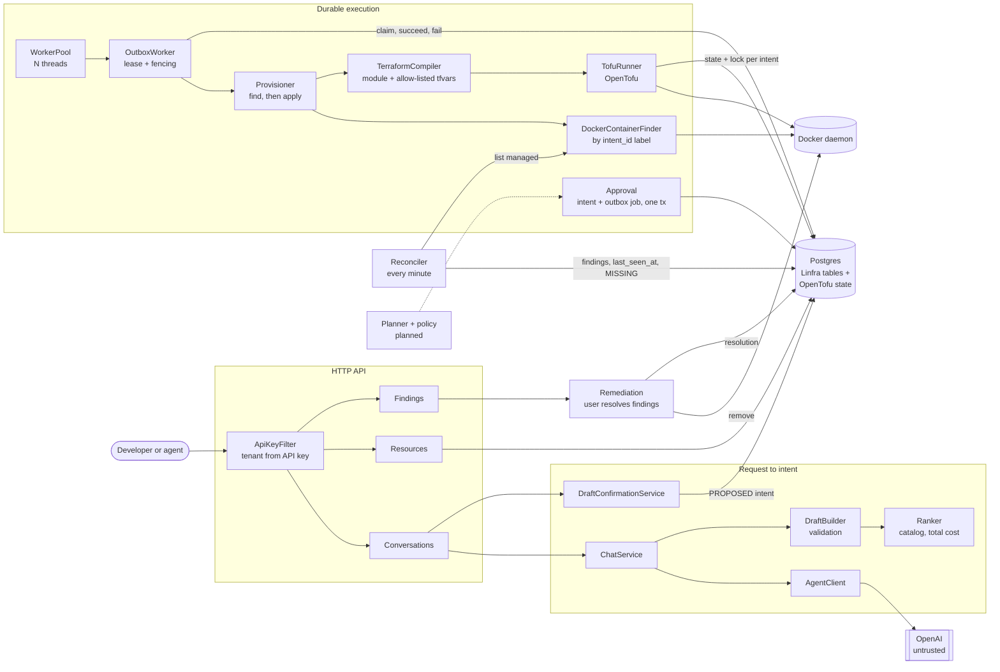

# Linfra

Linfra lets developers and AI agents get infrastructure by describing what they need, without handing an AI cloud
credentials. You chat ("a small VM for our staging API in the EU"), Linfra turns that into a typed request, picks the
best-fitting instance type on total monthly cost, and once you confirm, creates it through OpenTofu.

The core rule: **the model can propose, but only the system can act.** The LLM only extracts requirements. Choosing
the instance, generating infrastructure code and applying it are all deterministic, validated steps it can't
influence beyond a schema-checked request.

What it guarantees:

- **At most one resource per approved request**, even if a worker crashes mid-apply. Work goes through a Postgres
  outbox with leases and fencing tokens, and every retry first checks whether the resource already exists.
- **Every request ends in a known state**: succeeded, failed, expired, or flagged for a human.
- **The provider is the source of truth.** A reconciler compares what actually exists with Linfra's records every
  minute and reports drift, missing resources, orphans and duplicates as findings a user resolves.
- **Tenant isolation.** Each API key sees only its own conversations, intents and resources.
- **No injection into infrastructure code.** Linfra never generates Terraform, only allow-listed variable values for
  checked-in modules.

It's a sandbox project: VMs are Docker containers on a local, simulated cloud, so everything runs without a cloud
account. Planning with policy-based approval is next. Feature documentation lives in [docs/](docs/).

## Architecture

Spring Boot (Kotlin), Postgres, JPA, Flyway, OpenTofu. Spring AI talks to OpenAI. The only provider today is a local,
simulated cloud where Docker containers stand in for VMs; real clouds plug into the same seams.

The LLM never reaches a cloud: everything after the draft is deterministic code. No external call (LLM, OpenTofu or
Docker) runs inside a database transaction.

### Request flow

1. A user chats; the LLM turns the request into typed requirements. Invalid output never becomes a draft.
2. The ranker picks the instance type from the catalog; the user confirms the draft, which creates a `PROPOSED` intent.
3. Approval (planner and policy are next) moves the intent to `APPROVED` and inserts its outbox job in one transaction.
4. A worker thread claims the job with a lease and fencing token, records the run, calls `find()`, and only if nothing
   exists runs `tofu apply`.
5. The resource row and `SUCCEEDED` commit together. The reconciler keeps checking the provider against the records
   and opens findings; users resolve them with the actions each finding offers.

### Modules

| Module | Responsibility |
|---|---|
| `tenant` | API key authentication; the tenant on every request |
| `conversation` | Chat with the LLM, drafts, draft confirmation |
| `ranker` | Deterministic instance type choice from the catalog |
| `intent` | Intent state machine and approval |
| `terraform` | Intent → checked-in module plus allow-listed `terraform.tfvars.json`; runs OpenTofu |
| `outbox` | Durable job queue, worker thread pool, leases, fencing |
| `provider` | `find()` by label and `apply()` through OpenTofu; Docker today |
| `resource` | Resources Linfra created, one per succeeded intent |
| `reconciler` | Compares the provider with Linfra's records every minute and records findings |
| `remediation` | Findings, the actions each offers, and running the action a user picks |
| `common` | Mapping domain exceptions to HTTP statuses |

Each module is split into `model`, `persistence`, `service`, `rest`, `exception` and `config` packages.

### Data

| Table | Holds |
|---|---|
| `tenants` | Tenant and the SHA-256 hash of its API key |
| `conversations`, `messages` | Chat history; assistant messages carry the draft |
| `intents` | One request for one resource: state, spec, plan hash, approval, link to the confirmed draft |
| `outbox_jobs` | One job per approved intent: status, lease, fencing token, attempts |
| `runs` | One row per claim, written before any cloud call |
| `resources` | What was created: provider, region, instance type, cloud id, outputs, status |
| `findings` | What the reconciler found, its status, and the action a user took |
| `terraform_remote_state.states` | OpenTofu state, one workspace per intent (managed by OpenTofu, not Flyway) |
