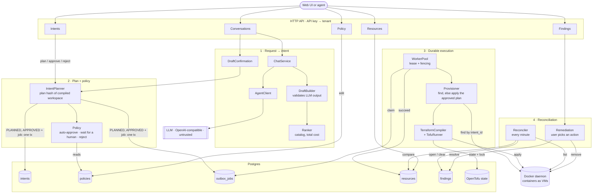

# Linfra

Linfra lets developers and AI agents get infrastructure by describing what they need, without handing an AI cloud
credentials. You chat ("a small VM for our staging API in the EU"), Linfra turns that into a typed request, picks the
best-fitting instance type on total monthly cost, and once you confirm, creates it through OpenTofu.

The core rule: **the model can propose, but only the system can act.** The LLM only extracts requirements. Choosing
the instance, generating infrastructure code and applying it are all deterministic, validated steps it can't
influence beyond a schema-checked request.

What it guarantees:

- **At most one resource per approved request**, even if a worker crashes mid-apply. Work goes through a Postgres
  outbox with leases and fencing tokens, and every retry first checks whether the resource already exists.
- **Every request ends in a known state**: succeeded, failed, expired, or flagged for a human.
- **The provider is the source of truth.** A reconciler compares what actually exists with Linfra's records every
  minute and reports drift, missing resources, orphans and duplicates as findings a user resolves.
- **Tenant isolation.** Each API key sees only its own conversations, intents, resources, findings and policy.
- **No injection into infrastructure code.** Linfra never generates Terraform, only allow-listed variable values for
  checked-in modules.
- **Policy before anything runs.** Each request is checked against its tenant's allowed types, regions and monthly
  budget: within limits it's approved automatically, above them a human approves, and approval is bound to the exact
  plan that will be applied.

It's a sandbox project: VMs are Docker containers on a local, simulated cloud, so everything runs without a cloud
account. Feature documentation lives in [docs/](docs/); a minimal web UI lives in
[linfra-fe](https://github.com/enismustafaj/linfra-fe).

## Running locally

**Prerequisites:** JDK 21+, Maven, Docker, [OpenTofu](https://opentofu.org) on the `PATH` (`brew install opentofu`),
Node.js for the web UI, and an API key for an OpenAI-compatible LLM (OpenAI or OpenRouter).

1. **Start Postgres** (Linfra's tables and OpenTofu's state live in it):
   ```sh
   docker compose up -d
   ```

2. **Start the backend** on `:8080`. Flyway creates the schema on first start.
   ```sh
   mvn -DskipTests package
   OPENAI_API_KEY=sk-... java -jar target/resource-app-0.0.1-SNAPSHOT.jar
   ```
   For OpenRouter, also set `OPENAI_BASE_URL=https://openrouter.ai/api` and `OPENAI_MODEL=openai/gpt-4.1-mini`.

3. **Create a tenant.** Its API key is `demo-key`; only the key's hash is stored:
   ```sh
   docker compose exec postgres psql -U linfra -d linfra -c \
     "insert into tenants (id, name, api_key_hash) values (gen_random_uuid(), 'demo', encode(sha256('demo-key'), 'hex'));"
   ```

4. **Start the web UI** from [linfra-fe](https://github.com/enismustafaj/linfra-fe) and open http://localhost:4200.
   Its dev server proxies `/api` to `:8080` and adds `demo-key` to every call.
   ```sh
   cd ../linfra-fe && npm install && npm start
   ```

Or call the API directly with `Authorization: Bearer demo-key`, e.g.
`curl -H "Authorization: Bearer demo-key" localhost:8080/api/v1/intents`.

### Configuration

| Variable | Default | |
|---|---|---|
| `OPENAI_API_KEY` | none | Without it, chat replies with `503`; everything else works |
| `OPENAI_BASE_URL` | `https://api.openai.com` | Any OpenAI-compatible API with structured outputs |
| `OPENAI_MODEL` | `gpt-4.1-mini` | |
| `DB_URL`, `DB_USER`, `DB_PASSWORD` | `jdbc:postgresql://localhost:5432/linfra`, `linfra`, `linfra` | |
| `WORKER_THREADS` | `4` | Worker threads per process |
| `LINFRA_RECONCILER_ENABLED` | `true` | Reconciler runs every minute |
| `PORT` | `8080` | |

Policy defaults (monthly budget €200, auto-approve up to €50, production needs approval) are in
`application.yaml` under `linfra.policy`; each tenant can override them on the Policy page.

### Tests

```sh
mvn verify          # unit and integration tests against Postgres in Testcontainers; needs Docker
mvn verify -Ptofu   # adds OpenTofu module tests and real provisioning on Docker; needs tofu
```

### Cleaning up

Containers Linfra created carry the `managed_by=linfra` label:

```sh
docker rm -f $(docker ps -aq --filter label=managed_by=linfra)
docker volume rm $(docker volume ls -q --filter label=managed_by=linfra)
docker compose down -v   # also deletes the database, including OpenTofu state
```

## Architecture

Spring Boot (Kotlin), Postgres, JPA, Flyway, OpenTofu. Spring AI talks to any OpenAI-compatible API (OpenAI,
OpenRouter). The only provider today is a local, simulated cloud where Docker containers stand in for VMs; real clouds
plug into the same seams.



The LLM never reaches a cloud: everything after the draft is deterministic code. No external call (LLM, OpenTofu or
Docker) runs inside a database transaction.

### Request flow

1. A user chats; the LLM turns the request into typed requirements. Invalid output never becomes a draft.
2. The ranker picks the instance type from the catalog; the user confirms the draft, which creates an intent.
3. In the same transaction, the planner hashes the compiled workspace and the tenant's policy decides: approved (with
   its outbox job), waiting for a human to approve on the Intents page, or rejected.
4. A worker thread claims the job with a lease and fencing token, records the run, calls `find()`, and only if nothing
   exists runs `tofu apply`, after checking that the workspace still hashes to the approved plan.
5. The resource row and `SUCCEEDED` commit together. The reconciler keeps checking the provider against the records
   and opens findings; users resolve them with the actions each finding offers.

### Modules

| Module | Responsibility |
|---|---|
| `tenant` | API key authentication; the tenant on every request |
| `conversation` | Chat with the LLM, drafts, draft confirmation |
| `ranker` | Deterministic instance type choice from the catalog |
| `intent` | Intent state machine, planning, approval |
| `policy` | Per-tenant rules: allowed types and regions, budget, when a human must approve |
| `terraform` | Intent → checked-in module plus allow-listed `terraform.tfvars.json`; runs OpenTofu |
| `outbox` | Durable job queue, worker thread pool, leases, fencing |
| `provider` | `find()` by label and `apply()` through OpenTofu; Docker today |
| `resource` | Resources Linfra created, one per succeeded intent |
| `reconciler` | Compares the provider with Linfra's records every minute and records findings |
| `remediation` | Findings, the actions each offers, and running the action a user picks |
| `common` | Mapping domain exceptions to HTTP statuses |

Each module is split into `model`, `persistence`, `service`, `rest`, `exception` and `config` packages.

### Data

| Table | Holds |
|---|---|
| `tenants` | Tenant and the SHA-256 hash of its API key |
| `conversations`, `messages` | Chat history; assistant messages carry the draft |
| `intents` | One request for one resource: state, spec, plan hash, approval and its reason, link to the confirmed draft |
| `policies` | Per-tenant policy; tenants without a row get the configured defaults |
| `outbox_jobs` | One job per approved intent: status, lease, fencing token, attempts |
| `runs` | One row per claim, written before any cloud call |
| `resources` | What was created: provider, region, instance type, cloud id, outputs, status |
| `findings` | What the reconciler found, its status, and the action a user took |
| `terraform_remote_state.states` | OpenTofu state, one workspace per intent (managed by OpenTofu, not Flyway) |
